# Genuine outlier gallery

Exact published source crops, frozen-pose rectification and saved scoring/fitted polygons. Yellow expected, cyan fitted, orange extra, magenta missing. WITHHELD percentages are offline diagnostics, never enabled QC scores. A source-model conflict excludes a comparison from the genuine baseline even when the app area gate cleared.

See [evidence review](EVIDENCE_REVIEW.md), [all marker results](per_marker.csv) and [model provenance conflicts](model_provenance_conflicts.csv).

## submariner_124060 — baton 6 — 855041528fc1ac79

Original runner-selected outlier; exact saved polygons; no severity assigned

Recorded watch group: auto_ewc_124060_5812eb095371 (provisional_inferred_listing_group).

Extra 6.931386% + missing 0.000000% = 6.931386%.

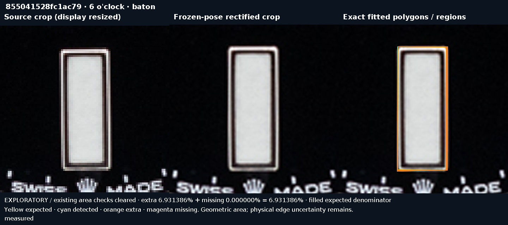

[Source listing](https://www.europeanwatch.com/watch/rolex-124060-submariner-124060-no-date-ceramic-bezel-41mm-49845) · [Recorded original image URL](https://images.europeanwatch.com/images/49/49845-1.jpg)

Area status/reason: measured

## submariner_124060 — baton 9 — 448814812e7079fd

Original runner-selected outlier; exact saved polygons; no severity assigned

Recorded watch group: auto_ewc_124060_dd10dd8bfba9 (provisional_inferred_listing_group).

Extra 5.817395% + missing 0.000000% = 5.817395%.

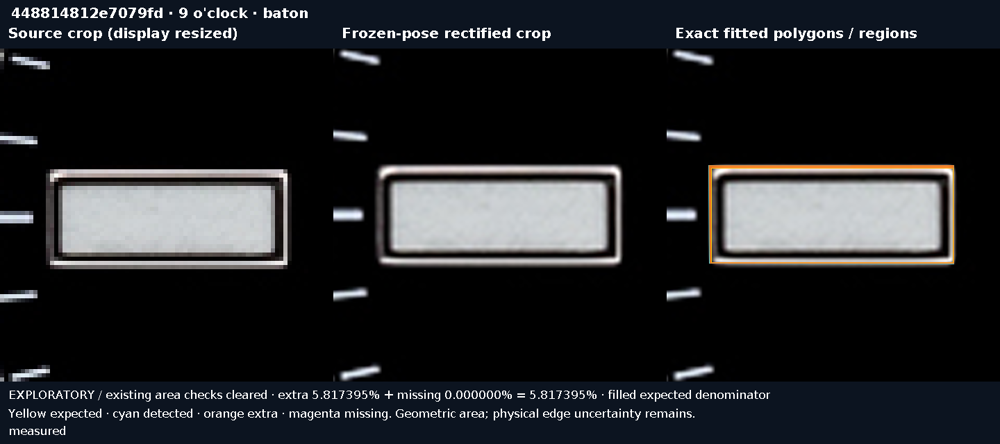

[Source listing](https://www.europeanwatch.com/watch/rolex-124060-124060-submariner-no-date-ss-black-dial-72241) · [Recorded original image URL](https://images.europeanwatch.com/images/72/72241-1.jpg)

Area status/reason: measured

## submariner_124060 — baton 6 — 5986c5a3258ae9ec

Original runner-selected outlier; exact saved polygons; no severity assigned

Recorded watch group: auto_swe_124060_3a43ecd6a5fa (provisional_inferred_listing_group).

Extra 12.365142% + missing 0.824038% = 13.189180%.

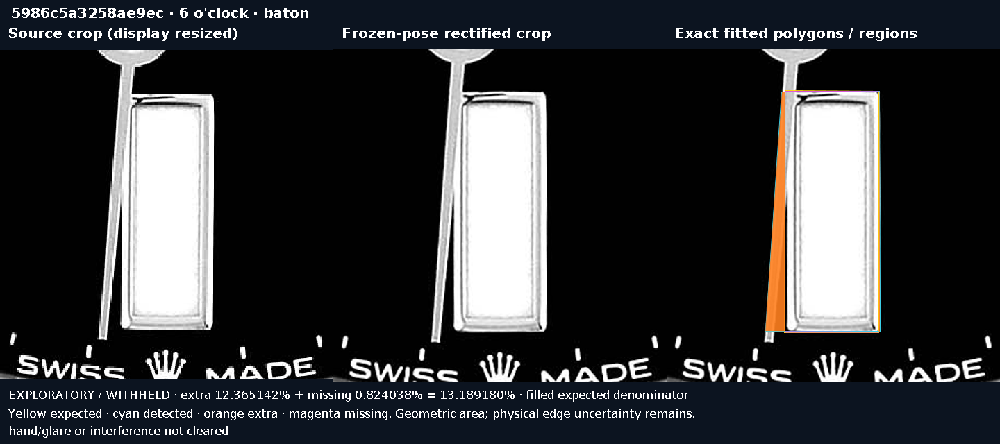

[Source listing](https://www.swisswatchexpo.com/watches/rolex-submariner-no-date-steel-ceramic-bezel-mens-watch-124060-box-card-83537) · [Recorded original image URL](https://cdn.swisswatchexpo.com/productphotos/9/15/rolex-submariner-no-date-steel-ceramic-bezel-mens-watch-124060-box-card-83537_5e0e9.jpg)

Area status/reason: hand/glare or interference not cleared

## submariner_124060 — round 11 — f27a64f84579f41b

Original runner-selected outlier; exact saved polygons; no severity assigned

Recorded watch group: auto_swe_124060_053392110b92 (provisional_inferred_listing_group).

Extra 0.060891% + missing 3.980622% = 4.041513%.

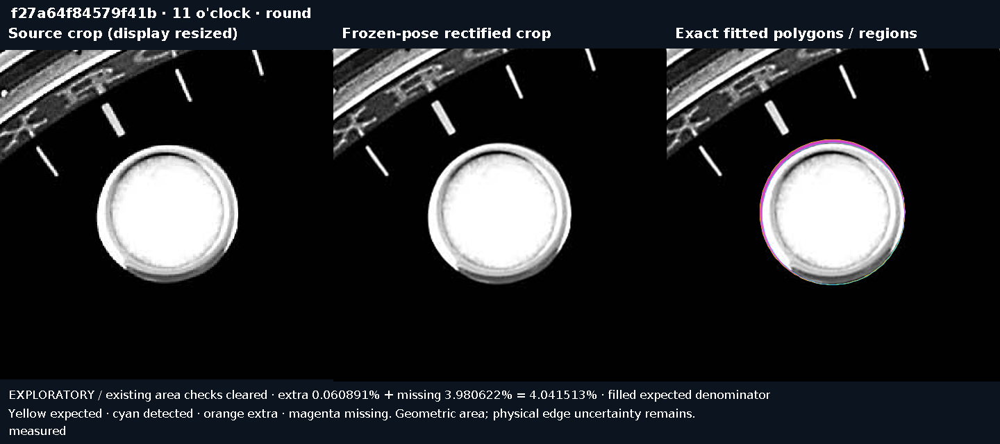

[Source listing](https://www.swisswatchexpo.com/watches/rolex-submariner-non-date-ceramic-bezel-steel-mens-watch-124060-47665) · [Recorded original image URL](https://cdn.swisswatchexpo.com/productphotos/11/19/rolex-submariner-non-date-ceramic-bezel-steel-mens-watch-124060-47665_aada7.jpg)

Area status/reason: measured

## submariner_124060 — round 10 — c2c6f5cc69fa1c6c

Original runner-selected outlier; exact saved polygons; no severity assigned

Recorded watch group: auto_bobs_124060_53360dc3b324 (provisional_inferred_listing_group).

Extra 1.219825% + missing 2.818411% = 4.038236%.

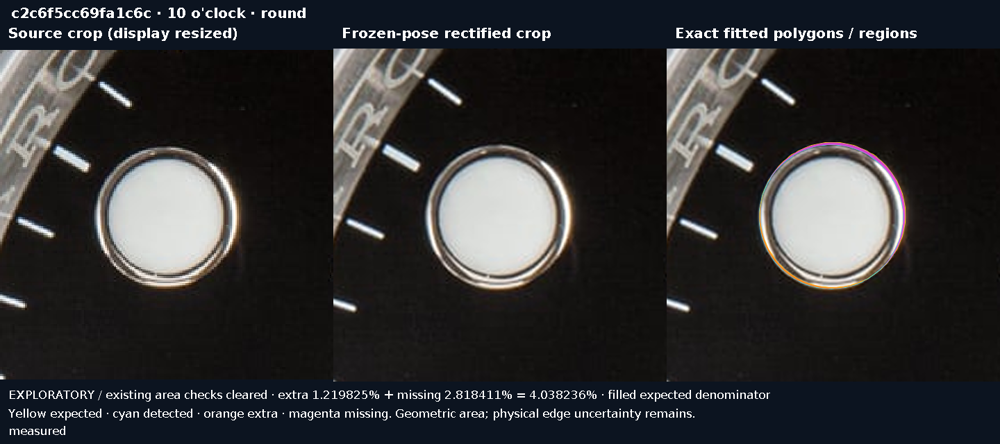

[Source listing](https://www.bobswatches.com/pre-owned-steel-rolex-submariner-ref-124060-black-cerachrom-bezel.html) · [Recorded original image URL](https://www.bobswatches.com/images/zUsed-Rolex-Submariner-124060-SKU192468.jpg)

Area status/reason: measured

## submariner_124060 — round 8 — 855041528fc1ac79

Original runner-selected outlier; exact saved polygons; no severity assigned

Recorded watch group: auto_ewc_124060_5812eb095371 (provisional_inferred_listing_group).

Extra 0.000000% + missing 15.887551% = 15.887551%.

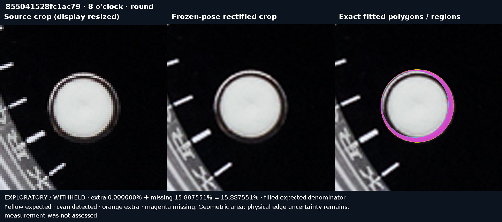

[Source listing](https://www.europeanwatch.com/watch/rolex-124060-submariner-124060-no-date-ceramic-bezel-41mm-49845) · [Recorded original image URL](https://images.europeanwatch.com/images/49/49845-1.jpg)

Area status/reason: measurement was not assessed

## submariner_124060 — triangle 12 — 14a800efc5982cf7

Original runner-selected outlier; exact saved polygons; no severity assigned

Recorded watch group: auto_ewc_124060_7761710b6ccf (provisional_inferred_listing_group).

Extra 13.944586% + missing 0.000000% = 13.944586%.

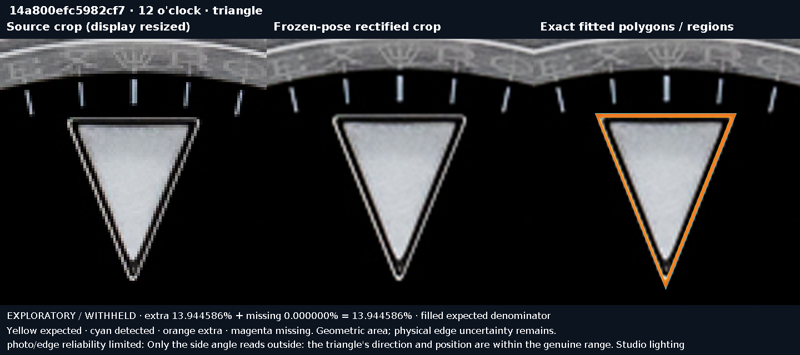

[Source listing](https://www.europeanwatch.com/watch/rolex-124060-124060-submariner-no-date-41mm-ss-black-dial-71758) · [Recorded original image URL](https://images.europeanwatch.com/images/71/71758-1.jpg)

Area status/reason: photo/edge reliability limited: Only the side angle reads outside: the triangle's direction and position are within the genuine range. Studio lighting can move a side edge without the marker moving, so a side angle on its own is shown as worth a look, not a clear finding.

## submariner_124060 — triangle 12 — 8cc107d61cf3afca

Original runner-selected outlier; exact saved polygons; no severity assigned

Recorded watch group: auto_ewc_124060_61da7322ed22 (provisional_inferred_listing_group).

Extra 13.918729% + missing 0.000000% = 13.918729%.

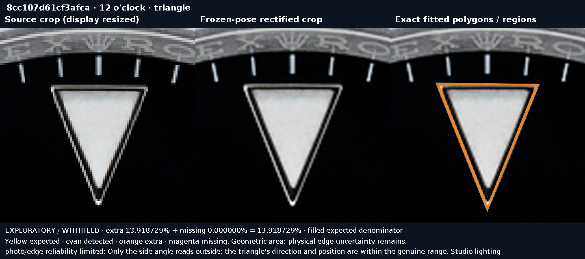

[Source listing](https://www.europeanwatch.com/watch/rolex-124060-124060-submariner-no-date-41mm-ss-black-dial-2026-68145) · [Recorded original image URL](https://images.europeanwatch.com/images/68/68145-1.jpg)

Area status/reason: photo/edge reliability limited: Only the side angle reads outside: the triangle's direction and position are within the genuine range. Studio lighting can move a side edge without the marker moving, so a side angle on its own is shown as worth a look, not a clear finding.

## gmt_126710 — baton 9 — b0a1a6ff0bf6db97

MODEL CONFLICT: diagnostic comparison against declared reference only; excluded from genuine baseline

Recorded watch group: hv_page_4cffae5ac4 (provisional_inferred_listing_group).

Extra 4.944206% + missing 0.205203% = 5.149409%.

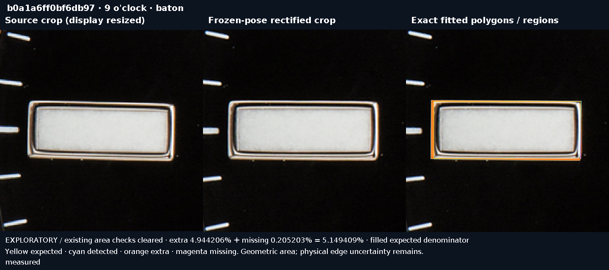

[Source listing](https://bobswatches.com/pre-owned-stainless-steel-rolex-gmt-master-ii-ref-116710blnr-batman.html) · [Recorded original image URL](https://www.bobswatches.com/images/zUsed-Rolex-GMT-Master-II-116710-SKU191844.jpg)

Area status/reason: measured

## gmt_126710 — baton 9 — 708ff4c725496d44

Original runner-selected outlier; exact saved polygons; no severity assigned

Recorded watch group: hv_page_58aba667cf (provisional_inferred_listing_group).

Extra 4.711340% + missing 0.000274% = 4.711614%.

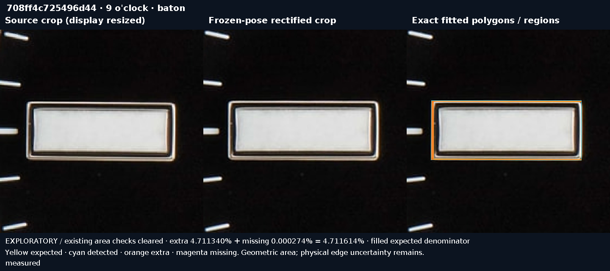

[Source listing](https://bobswatches.com/mens-rolex-gmt-master-ii-ref-126710grnr-jubilee.html) · [Recorded original image URL](https://www.bobswatches.com/images/zUsed-Rolex-GMT-Master-II-126710-Black-Dial-SKU182968.jpg)

Area status/reason: measured

## gmt_126710 — baton 9 — a5bfa50b177fadd3

Original runner-selected outlier; exact saved polygons; no severity assigned

Recorded watch group: hv_page_b0bc85b625 (provisional_inferred_listing_group).

Extra 3.839625% + missing 0.000000% = 3.839625%.

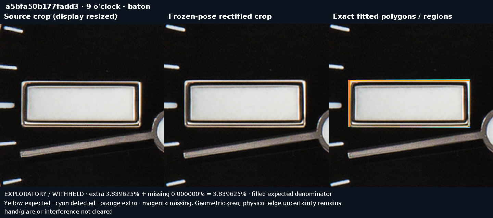

[Source listing](https://bobswatches.com/used-rolex-gmt-master-ii-ref-126710grnr-grey-and-black-bruce-wayne.html) · [Recorded original image URL](https://www.bobswatches.com/images/zPre-Owned-Rolex-GMT-Master-II-126710-SKU187386-Black-Dial.jpg)

Area status/reason: hand/glare or interference not cleared

## gmt_126710 — round 10 — c79c7553f6f5a5b2

Original runner-selected outlier; exact saved polygons; no severity assigned

Recorded watch group: hv_page_353f1de4ef (provisional_inferred_listing_group).

Extra 2.978785% + missing 0.243292% = 3.222077%.

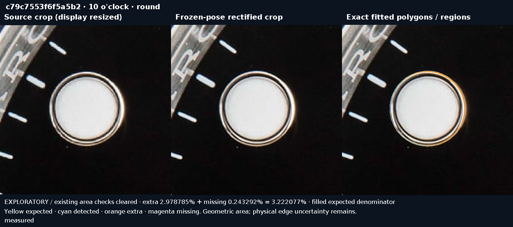

[Source listing](https://bobswatches.com/used-rolex-gmt-master-ii-ref-126710blnr-batman.html) · [Recorded original image URL](https://www.bobswatches.com/images/zUsed-Rolex-GMT-Master-II-126710-SKU186270.jpg)

Area status/reason: measured

## gmt_126710 — round 11 — c652c207a6b82064

Original runner-selected outlier; exact saved polygons; no severity assigned

Recorded watch group: hv_page_1696f9915b (provisional_inferred_listing_group).

Extra 2.399989% + missing 0.610507% = 3.010496%.

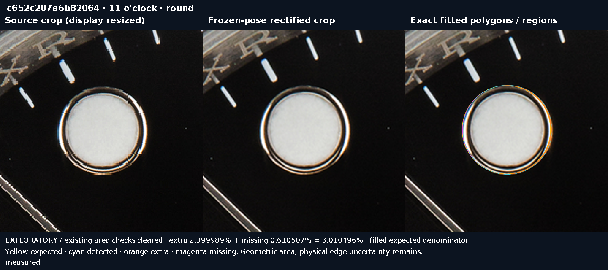

[Source listing](https://bobswatches.com/used-rolex-gmt-master-ii-ref-126710blnr-batgirl.html) · [Recorded original image URL](https://www.bobswatches.com/images/zUsed-Rolex-GMT-Master-II-126710-SKU186981.jpg)

Area status/reason: measured

## gmt_126710 — round 4 — ad1ae3e5b9609de8

Original runner-selected outlier; exact saved polygons; no severity assigned

Recorded watch group: swe_68351 (recorded_listing_or_lot_group).

Extra 3.215135% + missing 0.000000% = 3.215135%.

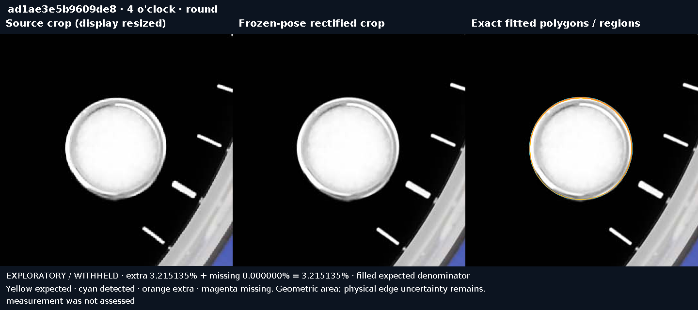

[Source listing](https://swisswatchexpo.com/watches/rolex-gmt-master-ii-batgirl-black-blue-bezel-steel-mens-watch-126710-card-68351) · [Recorded original image URL](https://cdn.swisswatchexpo.com/productphotos/2/20/rolex-gmt-master-ii-batgirl-black-blue-bezel-steel-mens-watch-126710-card-68351_f20d3.jpg)

Area status/reason: measurement was not assessed

## gmt_126710 — triangle 12 — 7f94f08a2015c94e

Original runner-selected outlier; exact saved polygons; no severity assigned

Recorded watch group: hv_page_7a187edba5 (provisional_inferred_listing_group).

Extra 14.535282% + missing 0.000000% = 14.535282%.

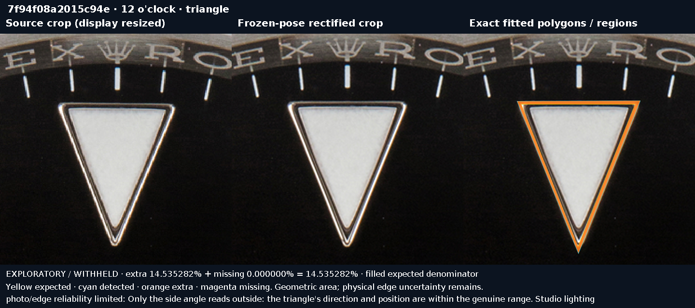

[Source listing](https://bobswatches.com/pre-owned-batgirl-rolex-gmt-master-ii-ref-126710blnr-jubilee-bracelet.html) · [Recorded original image URL](https://www.bobswatches.com/images/zUsed-Rolex-GMT-Master-II-126710-SKU186836.jpg)

Area status/reason: photo/edge reliability limited: Only the side angle reads outside: the triangle's direction and position are within the genuine range. Studio lighting can move a side edge without the marker moving, so a side angle on its own is shown as worth a look, not a clear finding.

## gmt_126710 — triangle 12 — b0a1a6ff0bf6db97

MODEL CONFLICT: diagnostic comparison against declared reference only; excluded from genuine baseline

Recorded watch group: hv_page_4cffae5ac4 (provisional_inferred_listing_group).

Extra 13.932956% + missing 0.000000% = 13.932956%.

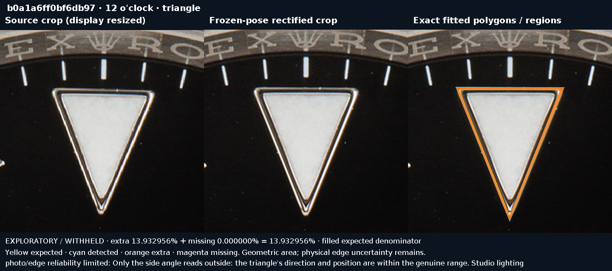

[Source listing](https://bobswatches.com/pre-owned-stainless-steel-rolex-gmt-master-ii-ref-116710blnr-batman.html) · [Recorded original image URL](https://www.bobswatches.com/images/zUsed-Rolex-GMT-Master-II-116710-SKU191844.jpg)

Area status/reason: photo/edge reliability limited: Only the side angle reads outside: the triangle's direction and position are within the genuine range. Studio lighting can move a side edge without the marker moving, so a side angle on its own is shown as worth a look, not a clear finding.

## submariner_126610 — baton 6 — 821f211e705bfd5b

Original runner-selected outlier; exact saved polygons; no severity assigned

Recorded watch group: bobs_126610_184365 (recorded_listing_or_lot_group).

Extra 3.402685% + missing 0.200671% = 3.603356%.

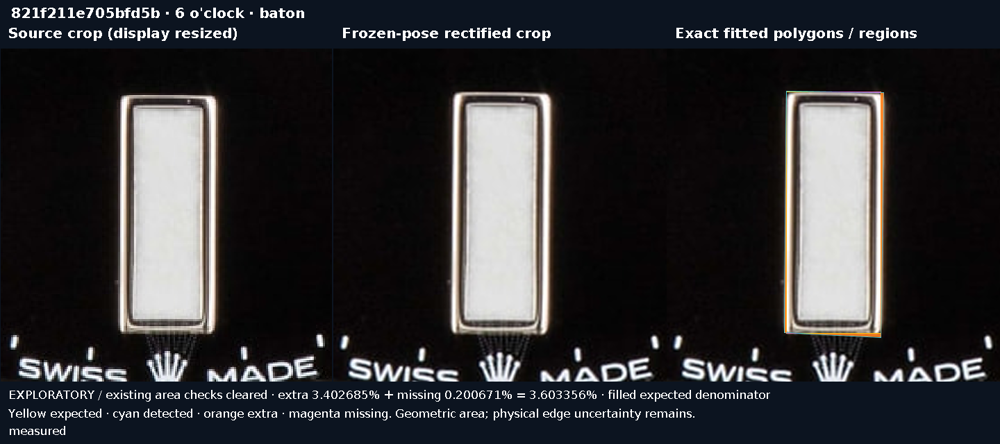

[Source listing](https://www.bobswatches.com/mens-rolex-submariner-stainless-steel-126610-black-dial.html) · [Recorded original image URL](https://www.bobswatches.com/images/zUsed-Rolex-Submariner-126610-Black-Dial-SKU184365.jpg)

Area status/reason: measured

## submariner_126610 — baton 6 — 8b8dcdf8b24dfa70

Original runner-selected outlier; exact saved polygons; no severity assigned

Recorded watch group: bobs_126610_182339 (recorded_listing_or_lot_group).

Extra 2.263918% + missing 1.188445% = 3.452364%.

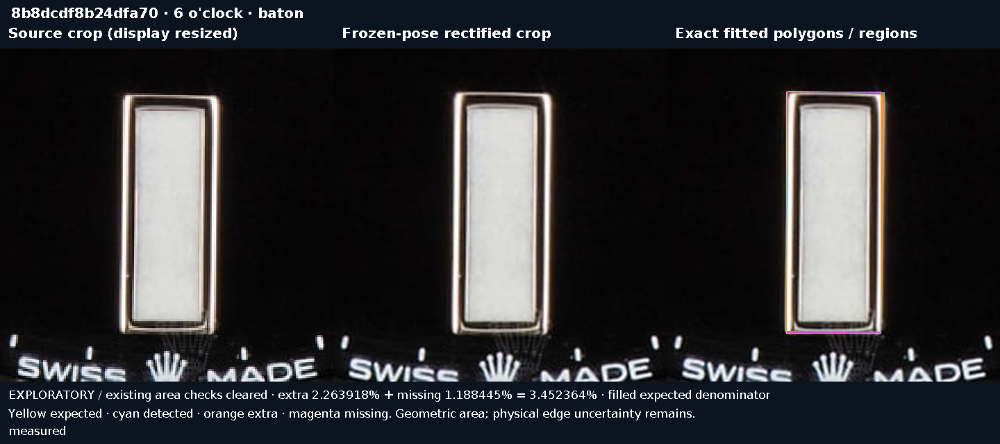

[Source listing](https://www.bobswatches.com/mens-rolex-submariner-ref-126610-steel.html) · [Recorded original image URL](https://www.bobswatches.com/images/zUsed-Rolex-Submariner-126610-Black-Dial-SKU182339.jpg)

Area status/reason: measured

## submariner_126610 — baton 9 — 4cf1d7e23e0cb03c

Original runner-selected outlier; exact saved polygons; no severity assigned

Recorded watch group: bobs_126610_183342 (recorded_listing_or_lot_group).

Extra 2.650602% + missing 1.934997% = 4.585599%.

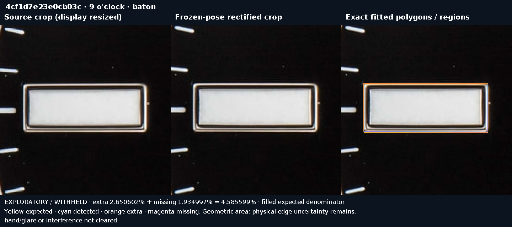

[Source listing](https://www.bobswatches.com/preowned-rolex-submariner-ref-126610-black.html) · [Recorded original image URL](https://www.bobswatches.com/images/zUsed-Rolex-Submariner-126610-Black-Dial-SKU183342.jpg)

Area status/reason: hand/glare or interference not cleared

## submariner_126610 — round 11 — 4cf1d7e23e0cb03c

Original runner-selected outlier; exact saved polygons; no severity assigned

Recorded watch group: bobs_126610_183342 (recorded_listing_or_lot_group).

Extra 1.077878% + missing 1.940216% = 3.018094%.

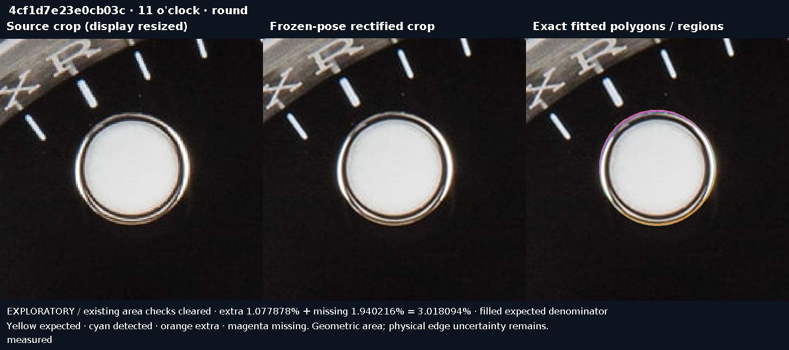

[Source listing](https://www.bobswatches.com/preowned-rolex-submariner-ref-126610-black.html) · [Recorded original image URL](https://www.bobswatches.com/images/zUsed-Rolex-Submariner-126610-Black-Dial-SKU183342.jpg)

Area status/reason: measured

## submariner_126610 — round 7 — a56186401b2a6332

Original runner-selected outlier; exact saved polygons; no severity assigned

Recorded watch group: bobs_126610_189540 (recorded_listing_or_lot_group).

Extra 0.392958% + missing 2.440860% = 2.833818%.

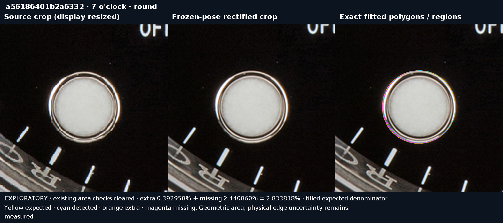

[Source listing](https://www.bobswatches.com/used-rolex-submariner-stainless-steel-126610-black-date-dial.html) · [Recorded original image URL](https://www.bobswatches.com/images/zUsed-Rolex-Submariner-126610-SKU189540.jpg)

Area status/reason: measured

## submariner_126610 — round 2 — 4cf1d7e23e0cb03c

Original runner-selected outlier; exact saved polygons; no severity assigned

Recorded watch group: bobs_126610_183342 (recorded_listing_or_lot_group).

Extra 1.040787% + missing 1.942692% = 2.983480%.

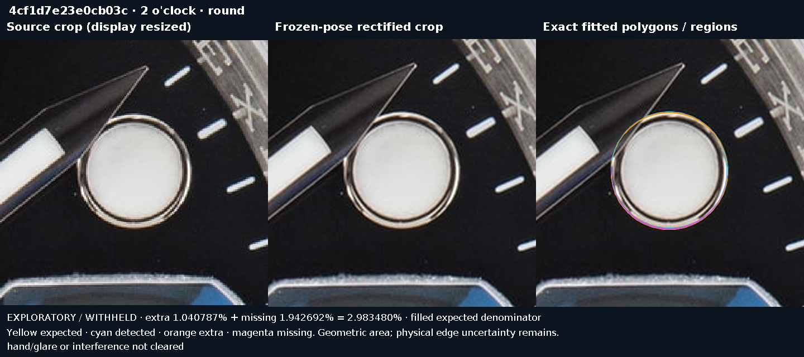

[Source listing](https://www.bobswatches.com/preowned-rolex-submariner-ref-126610-black.html) · [Recorded original image URL](https://www.bobswatches.com/images/zUsed-Rolex-Submariner-126610-Black-Dial-SKU183342.jpg)

Area status/reason: hand/glare or interference not cleared

## submariner_126610 — triangle 12 — 5dd3527c3a74bc6e

Original runner-selected outlier; exact saved polygons; no severity assigned

Recorded watch group: bobs_126610LV_189011 (recorded_listing_or_lot_group).

Extra 11.142633% + missing 0.000000% = 11.142633%.

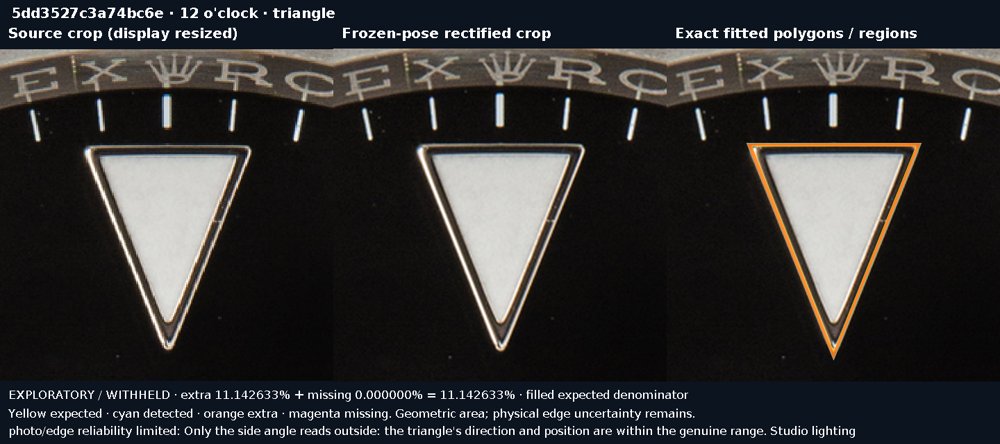

[Source listing](https://www.bobswatches.com/pre-owned-black-dial-rolex-submariner-date-ref-126610lv-green-bezel.html) · [Recorded original image URL](https://www.bobswatches.com/images/zUsed-Rolex-Submariner-126610-SKU189011.jpg)

Area status/reason: photo/edge reliability limited: Only the side angle reads outside: the triangle's direction and position are within the genuine range. Studio lighting can move a side edge without the marker moving, so a side angle on its own is shown as worth a look, not a clear finding.

## submariner_126610 — triangle 12 — 9f0e707ad066ee21

Original runner-selected outlier; exact saved polygons; no severity assigned

Recorded watch group: bobs_126610_184350 (recorded_listing_or_lot_group).

Extra 11.021191% + missing 0.000000% = 11.021191%.

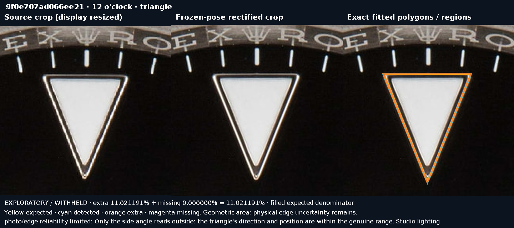

[Source listing](https://www.bobswatches.com/used-rolex-submariner-steel-oyster-126610-black-dial.html) · [Recorded original image URL](https://www.bobswatches.com/images/zUsed-Rolex-Submariner-126610-SKU184350.jpg)

Area status/reason: photo/edge reliability limited: Only the side angle reads outside: the triangle's direction and position are within the genuine range. Studio lighting can move a side edge without the marker moving, so a side angle on its own is shown as worth a look, not a clear finding.

