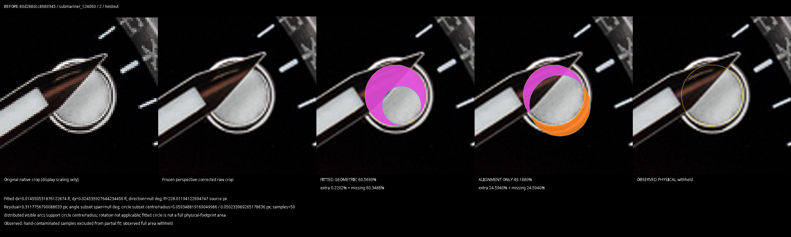
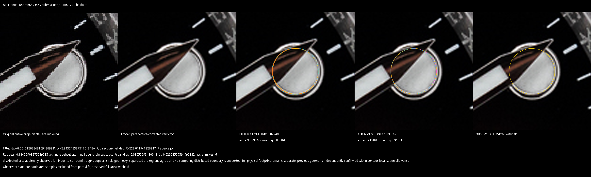
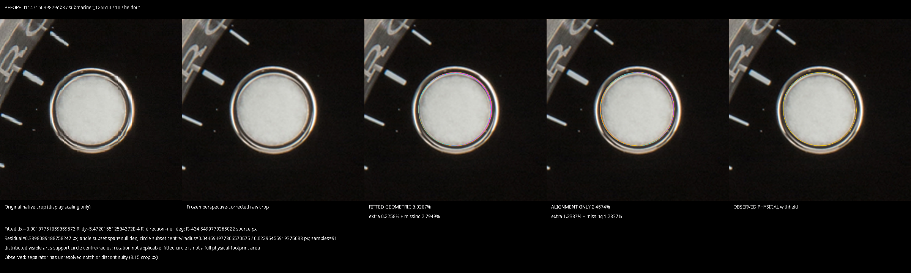
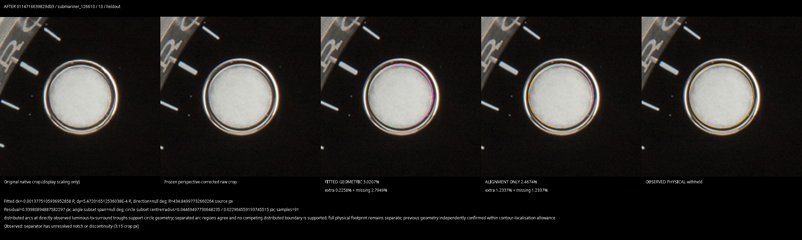
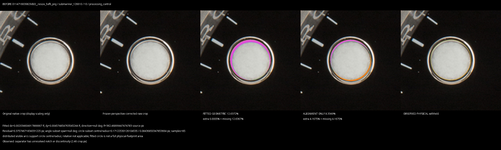
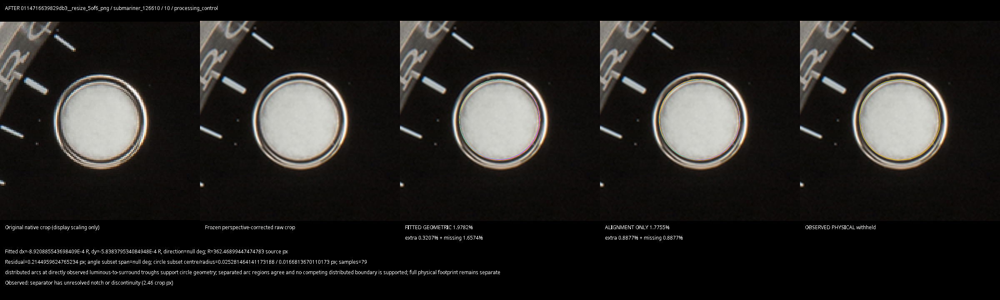

# Partial-edge luminous boundary correction

Baseline: `8a53c1e5`, isolated branch `fix/luminous-boundary-validation-20261012`.
The two documented false-circle cases are corrected. The additional processing
failure found during validation is withheld. No reference calibration, new
photograph collection, perspective change, outer-metal change, QC threshold,
classification change, PR #52 change or merge was performed.

## Exact evidence and reproduction

Reused [132-original artifact, run 38222239457](https://github.com/Biggregw/watch-align/actions/runs/38222239457)
and [completed calibration artifact, run 38295283386](https://github.com/Biggregw/watch-align/actions/runs/38295283386),
from `research/luminous-partial-calibration-20261012`. All original hashes were
verified. Pillow 12.3.0 reproduced all 18 archived processing-file hashes, including
the exact 5/6 LANCZOS resize. Originals were never re-encoded for measurement.
The supplied Batgirl original was verified as
`c50e0845ddb6c50701a4ba8ab6b396092e67988a747206f77743c02e7c7e54eb`.
Its original bytes are not committed.

The frozen pipeline reproduced 124060 / `80d288dcc8689345` / 2, including its
60.569019% study score, incorrect interior circle and low residual. It reproduced
126610 / `0114716639829db3` / 10 and its exact resized copy, including the
9.616509 percentage-point difference. Native-versus-archived arithmetic differs
by at most 0.000000158 in a pose coefficient; decoded image fingerprints agree.
Same-host exact-image repeats agree **exactly**, without numerical allowances.

The first candidate ran the full unchanged outer pipeline on all 132 originals
and 18 processing variants. The final additional circle gate replayed those
verified native pose/ring snapshots, regenerated the unchanged interference grids,
and required the same original hashes and decoded grayscale fingerprints. Full
pipeline and snapshot replay agree exactly on the focused 124060 checks. This is
a detector regression replay, not another calibration study.

See [replay instructions](../../../tools/luminous/boundary/README.md),
[original comparisons](original_comparison.csv),
[processing comparisons](processing_comparison.csv),
[Batgirl comparisons](batgirl_comparison.csv), and [validation checks](validation.json).
CSV `before/after_new_*` columns use the **unchanged completed-study references**;
`before/after_old_*` columns use the **unchanged APK reference assets**.

## Why the old fit was wrong

The fallback preferred the earliest radial brightness exit. Its metal-recovery
search could validate a shallow interior drop using a later, distant polished rim.
An accepted brightness-threshold contour could also replace those partial points.
RANSAC then retained the most convincing circle subset. Alternating subset agreement
and a small residual describe that selected geometry, not the identity of the edge.

Only the experimental circular path changed. New photographic arc samples require
a fall into a local dark trough and its immediately following surround recovery.
A drop that continues towards a deeper trough cannot borrow that later recovery.
The free circle must have distributed arc support, agree between separated arc
regions, and have no supported competing circle or spatially distributed
contradictory separator observations. These checks reuse the existing separator
contrast, three-region support and pixel-localisation gates; they create no QC bands.

A previous circle is retained exactly when independent photographic evidence
confirms it within the existing contour-localisation allowance. Otherwise it is
replaced by the independently supported circle, or withheld. The expected luminous
template and its mismatch percentage never select the boundary.

Independent triangle sides and baton edges are unchanged. A complete physical
boundary is not required for independent circular arcs to reconstruct geometry.
Observed full-footprint contours remain a separate measurement; a fitted circle
never supplies their missing material or corners.

## Documented cases — same completed-study reference before and after

| Original / marker | Fitted geometric before → after | Alignment-only before → after | Observed footprint | Boundary evidence |
|---|---:|---:|---|---|
| 124060 `80d288dcc8689345` / 2 | 60.569019 → 3.829376% | 49.187960 → 1.830037% | withheld → withheld | Original interior fit is replaced by the visible outer luminous separator; clear arcs away from the hand establish the circle. |
| 126610 `0114716639829db3` / 10, original | 3.020657 → 3.020657% | 2.467393 → 2.467393% | withheld → withheld | Previously correct geometry is independently confirmed and retained. |
| Same 126610 / 10, exact 5/6 resize | 12.637166 → 1.978163% | 8.334949 → 1.775480% | withheld → withheld | Interior/biased arc selection is replaced by the photographed luminous separator. |

The 124060 radius changes from 0.046346543 R to 0.074790572 R; the new circle
follows the visible insert rather than sitting inside it. Its source-pixel fit
residual is 0.144509. This residual is a stability diagnostic, not independent
metrology or proof of boundary accuracy. The labelled raw/fit comparisons below
provide the photographic check.

The documented resize difference falls from **9.616509 to 1.042494 percentage
points**. The original fit remains unchanged; improvement is not inferred merely
from a lower percentage. JPEG/brightness sensitivity also remains: the largest
retained 126610 round-marker processing difference is about 1.93 points. There is
no claim of complete resolution or interpolation invariance. The GMT control's
largest retained circular processing difference is 0.245264 points. The 124060
processing-control photograph's circular fits are withheld throughout; unavailable
measurements are not counted as zero sensitivity or as an improvement in precision.

### 124060 / 2

**BEFORE — incorrect interior circle**

**AFTER — circle follows the visible luminous-to-surround separator; full footprint withheld**

### 126610 / 10, original and resized

**BEFORE — original**

**AFTER — original geometry retained**

**BEFORE — exact resized copy, biased interior fit**

**AFTER — exact resized copy, outer luminous separator**

## A rejected candidate and the remaining uncertainty

The first candidate fixed the named failures but newly measured 124060
`c58f78ef6c1cd5b7` / 4 as 6.330340%, switching to 13.019578% under JPEG 95 and
12.332751% under −2% brightness, despite small residuals. It was **rejected before
building**. [Its recorded comparisons](rejected_candidate_processing.csv) are
retained separately. The final gate sees contradictory photographed separator arcs
across independent regions and withholds fitted geometry and alignment-only for
the original and all six processing variants. Two new tests guard this distinction:
distributed contradictions invalidate a fit; a local unresolved arc does not demand
a complete boundary when the remaining independent arcs establish geometry.

Across 1,056 attempted genuine circles, **593 previously fitted geometries remain
unchanged**, 153 change, 188 previously fitted circles are withheld, 9 become
supported, and 113 remain withheld. The 153 changes are not individually certified
as corrections merely because their percentages differ; the CSV labels them for
visual review. The demonstrated boundary fixes are the reviewed cases above and
the selected before/after evidence. A photograph can still hide the material
identity of a mathematically plausible edge.

113 previously available observed footprints are additionally withheld when their
circular boundary cannot be independently supported. Retained observed polygons
are not replaced or reshaped. This reduced coverage is deliberate abstention,
not a new QC classification or a larger genuine tolerance.

## Previously correct controls and validation

All **442 attempted genuine triangle/baton rows** retain their previous measurements
and withholding. All recorded outer QC fields and classifications are unchanged.
Three exact-original processing repeats reproduce decoded pixels, pose, ring,
measured polygons and scores exactly. The original Batgirl / 9 and / 12 marker
records also reproduce exactly. Its outer 9 remains −1.174605322° and WORTH.

The controls below retain fitted, alignment-only and observed measurements; the
figures are rounded for readability. Tiny archived/native arithmetic differences
are below 0.0000001 percentage point and are not detector changes.

| Genuine control / hour | Shape | Fitted before = after | Alignment before = after | Observed before = after |
|---|---|---:|---:|---:|
| GMT `c652c207a6b82064` / 4 | circle | 3.556483% | 1.459551% | 2.174971% |
| GMT `b5a3712a20ede636` / 12 | triangle | 3.807908% | 2.288653% | 3.293519% |
| GMT `c652c207a6b82064` / 9 | baton | 4.917350% | 1.217879% | 4.161140% |
| 124060 `033133202cf757da` / 1 | circle | 3.125054% | 3.125256% | 3.367370% |
| Same / 12 | triangle | 6.434564% | 7.500355% | 5.487924% |
| Same / 3 | baton | 3.712895% | 2.800397% | 3.409926% |
| 126610 `355d47df5ee1eee0` / 1 | circle | 3.819455% | 1.040003% | 2.569584% |
| Same / 12 | triangle | 2.747096% | 2.506145% | 3.029960% |
| Same / 9 | baton | 5.748088% | 2.764386% | 6.579931% |
| Batgirl original / 9 (existing APK reference) | baton | 16.179324% | 15.893279% | 15.944486% |
| Batgirl original / 12 (existing APK reference) | triangle | 8.327824% | 8.133098% | 6.883068% |

[Labelled unchanged-control close-ups](controls/) preserve the raw photographs and
exact fitted, alignment-only and observed comparison polygons for the nine genuine
controls above. [Original hashes and source locations](original_hashes.csv) identify
all 132 original files used in the replay.

**397 Android unit tests and 18 native shape/resolution/hand checks pass.** The new
tests use independently drawn luminous geometry, include stable-but-wrong interior
fits, ambiguous concentric boundaries, short arcs and partial boundaries. A focused
photographic replay is also required by the APK workflow. Build guards require
this report's exact detector-source hashes and forbid changes elsewhere in Android
apart from the detector, its tests and the separate experimental package metadata.

## Experimental APK and reference safeguard

The new package is `com.watchalign.mobile.poc.edgefit.luminousboundary`, labelled
**Watch Align Luminous Boundary**, arm64 only. It installs alongside existing builds.
[Download the APK](https://github.com/Biggregw/watch-align/releases/download/v1.4.0-alpha107.3-luminous-boundary-arm64/WatchAlign-alpha107.3-luminous-boundary-arm64.apk)
from the [separate prerelease](https://github.com/Biggregw/watch-align/releases/tag/v1.4.0-alpha107.3-luminous-boundary-arm64).
[Build and photographic checks](https://github.com/Biggregw/watch-align/actions/runs/38308367983)
and [verified artifact publication](https://github.com/Biggregw/watch-align/actions/runs/38308971958)
passed. APK source is `de29c0be1facb11ade0de6fcff933275ef70dda2`; SHA256 is
`25c2edad78add4d7b0391dd1edf7cb4d4be59c263120701e092b310969ee07eb`.
The 25,036,245-byte APK has only arm64 native libraries and a verified signature.
The shared signing secret was unavailable, so the existing debug-signing fallback
was used for this separate package. Samsung on-device execution is still untested
here; the desktop/native photographic replay and Android build checks passed.

All genuine and experimental reference assets remain byte-identical to `8a53c1e5`;
the completed calibration's research shapes are **not integrated into this APK**.
Consequently the app's existing-reference fitted readouts for the three documented
inputs are 2.159089%, 2.352771%, and 1.894466%, respectively. The report's primary
table uses the completed-study reference to reproduce the user's 60.569% case.

Every comparison still uses `100 × (extra + missing) / filled expected-template area`.
Alignment-only rigidly places the expected template without resizing it. FITTED
GEOMETRIC, alignment-only and OBSERVED percentages remain separate and are never added.
No new luminous pass/fail bands or production QC decisions are introduced.

## LESSONS LEARNED

Stable RANSAC subsets can describe the wrong physical feature. Even a better radial
selector can hide contradictory arcs as outliers; the additional processing control
exposed that failure before release. Photographic boundary identity must be checked
before geometric precision is interpreted. Remaining blur, lighting, partial
occlusion and competing edges require abstention rather than reference adjustment.
