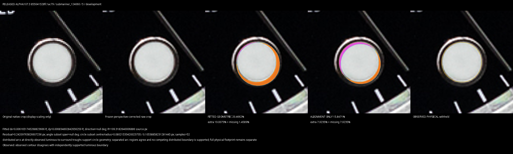
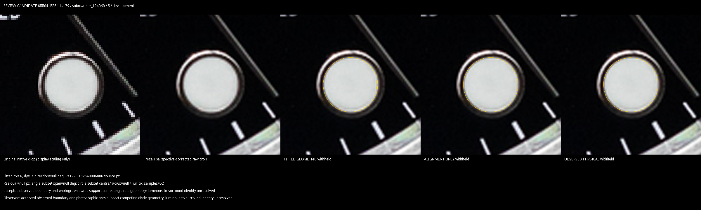
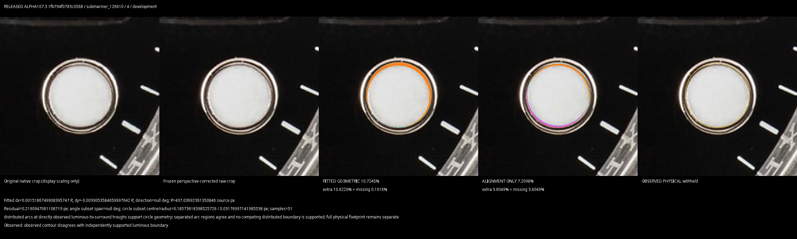
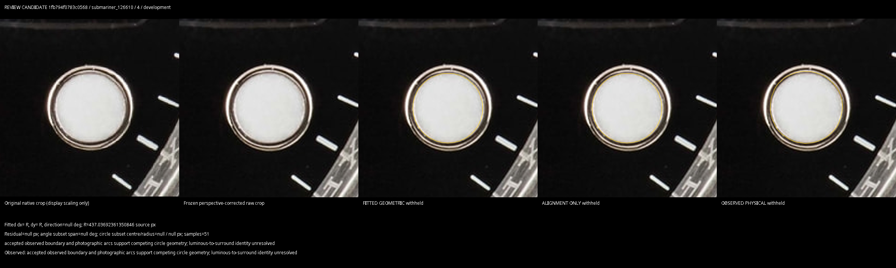
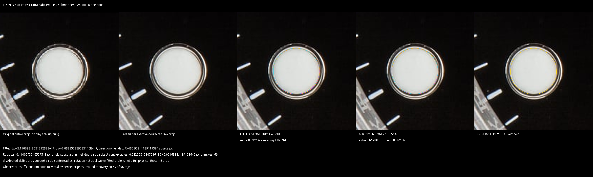
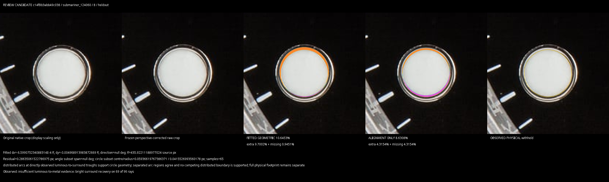

# Circular-boundary review — replacement APK blocked

The stronger photographic audit **fails**. Alpha107.3 can still select a metal
surround edge while reporting low residuals and stable subsets. This review improves
abstention, hand masking and regression coverage, but does not establish a reliable
correction for every reviewed case. **No replacement APK was built or published.**
The existing APK, its package/version and release assets are preserved.

## What changed

* Preserve alternative local brightness transitions rejected by the seed-connected
  bright-prefix check, and use them only to contradict a selected circle. An
  interior dark annulus previously erased evidence of the actual outer boundary.
* Withhold geometry as well as OBSERVED area when an accepted physical contour
  independently supports a conflicting circle. Alpha107.3 discarded the contour
  and trusted the new arcs, which sometimes followed metal.
* Apply the existing hand mask to provisional contour points and both circular
  evidence sets **before** circular validation. A first review candidate overwrote
  useful contour points with unmasked rays; that regression was corrected.
* Give fitted, alignment-only and OBSERVED comparisons their own withholding
  explanations. An unavailable fitted measurement no longer inherits “measured”
  from an available OBSERVED footprint.
* Strengthen the photographic/build gates: check centres, reconstructed polygons,
  radii, both fitted scores, OBSERVED withholding, reviewed unchanged controls,
  hand-obscured evidence, frozen archive hashes and measurement/replay/test hashes.
  Failed checks write their evidence and block APK assembly. Python optimization
  cannot disable the gates.

No perspective, outer-metal detector, genuine reference, mismatch denominator,
QC threshold/classification, PR #52 or merge changed. Independent triangle sides,
baton edges and partial circular arcs remain supported. Fitted geometry never
supplies an OBSERVED full footprint. All percentages still divide extra plus
missing area by the filled expected-template area; alignment-only moves/rotates
that template without resizing it.

## Actual-photo results

The table reports **FITTED GEOMETRIC** mismatch against the **unchanged
completed-study reference**, to reproduce the original documented failures.
Alignment-only and OBSERVED results have separate columns in the comparison CSVs. APK reference assets remain unchanged and produce
different readouts. “Withheld” is unavailable evidence, never zero mismatch.

| Genuine original / marker | Frozen baseline | Released alpha107.3 | Review candidate | Photographic conclusion |
|---|---:|---:|---:|---|
| 124060 `80d288dcc8689345` / 2 | 60.569019% | 3.829376% | 3.829376% | Reviewed correction to the outer luminous boundary retained. |
| 126610 `0114716639829db3` / 10 | 3.020657% | 3.020657% | 3.020657% | Correct original geometry retained. |
| Same / 10, exact 5/6 LANCZOS resize | 12.637166% | 1.978163% | 1.978163% | Reviewed boundary correction retained; original/resize difference remains 1.042494 points. |
| 124060 `855041528fc1ac79` / 5 | 3.38149% | 20.46620% | withheld | Released fit expands onto surround; independent contour disagreement now prevents that confident result. |
| 126610 `1fb794f0783c0568` / 4 | 1.44292% | 10.72450% | withheld | Released enlarged surround fit now withheld. |
| 124060 `c14f8b3abb49c038` / 8 | 1.40930% | 10.64531% | **10.64531% — FAIL** | Wrong upper metal-edge circle survives; blocks the APK. |

The remaining blocker is boundary identity, not its percentage. The correct upper
luminous exit in the exact rectified grayscale has a 17.50-level fall but only
3.44-level recovery; the existing selector discards it. A later bevel transition
has a 115.50-level fall and 14.19-level recovery and supplies the selected arcs.
Its 0.286351-source-pixel residual and stable subsets still describe the wrong
physical feature. Radius expands from 0.073682317 R to 0.077127809 R and the centre
moves towards the upper surround.

A bounded, contradiction-only probe retaining nearby continued falls was rejected:
it did not resolve this marker and also withheld the previously reviewed 124060 / 2
correction. It was not integrated. No image-ID exception, target percentage or
reference adjustment was used to make the audit pass.

The labelled close-ups show the raw original, frozen rectification and exact
measurement polygons. Compare the luminous material with the fit, not its score.
The two originally documented failure galleries remain in the
[historical report](../luminous-boundary-fix-2026-10-12/REPORT.md).

**124060 / 5 — released false metal fit → candidate withholding**





**126610 / 4 — released false metal fit → candidate withholding**





**Remaining 124060 / 8 blocker — previously correct boundary → unsafe candidate**





## Validation and reproduction

Replayed the existing **132 original genuine photographs, 18 archived processing
variants and the exact Batgirl original** using verified native pose/ring snapshots.
Replay checks original bytes, decoded grayscale fingerprints and unchanged
interference evidence. It does not estimate perspective or calibrate references.
Batgirl SHA-256 is
`c50e0845ddb6c50701a4ba8ab6b396092e67988a747206f77743c02e7c7e54eb`.
No photographs were harvested or re-encoded for original-image measurement.

**405 Android tests, 18 native controls and 14 Python gate tests pass.** Python
gate tests also pass with `-O`. This is distinct from photographic acceptance:
[validation.json](validation.json) records the real-photo failure and the build
guard rejects it. Exact-image repeats agree exactly; the nine reviewed genuine
circle/triangle/baton controls and Batgirl / 9 and / 12 remain stable. All 442
original genuine noncircular marker rows and the recorded outer QC results remain
unchanged. See [original comparison](original_comparison.csv),
[processing comparison](processing_comparison.csv),
[Batgirl comparison](batgirl_comparison.csv),
[alpha107.3 comparison](alpha107_3_comparison.csv) and
[verified original hashes](original_hashes.csv).

Against the frozen baseline, 579 previously fitted circles retain geometry, 242
are withheld, 113 change, six become supported and 116 remain withheld. An
additional 122 OBSERVED footprints are unavailable. Against alpha107.3, 695 fitted
circles retain geometry, 57 are newly withheld and three change after the hand
processing order fix; 301 remain unavailable. Coverage losses are abstentions, not
improved precision. The three changed hand cases are identified in the
[hand review](hand_review.csv). Their centre shifts are 0.026–0.144 source pixels
and radius shifts 0.071–0.453 pixels. Before/after photographs show the same visible
luminous edge; the change retains more provisional contour samples after hand
masking. It is a sampling/order change, not demonstrated improvement in physical
accuracy. Two of their mismatch percentages increase. Changed unreviewed circles are not certified as corrections. Repeated
bytes, low fit residuals, subset agreement and a lower percentage do not prove
boundary accuracy. The known false metal-edge result prevents promotion even
though the original two failures and selected controls remain improved/stable.

[Replay instructions](../../../tools/luminous/boundary/README.md) reproduce the
full audit from the existing artifacts and original Batgirl bytes. To verify that
this candidate cannot build:

```bash
python tools/luminous/boundary/verify_build.py
```

It must fail with “Photographic audit has unresolved failures; preserve the
existing APK.” Alpha107.3's circular measurements remain provisional; preserving
its binary does not certify them as trustworthy.
