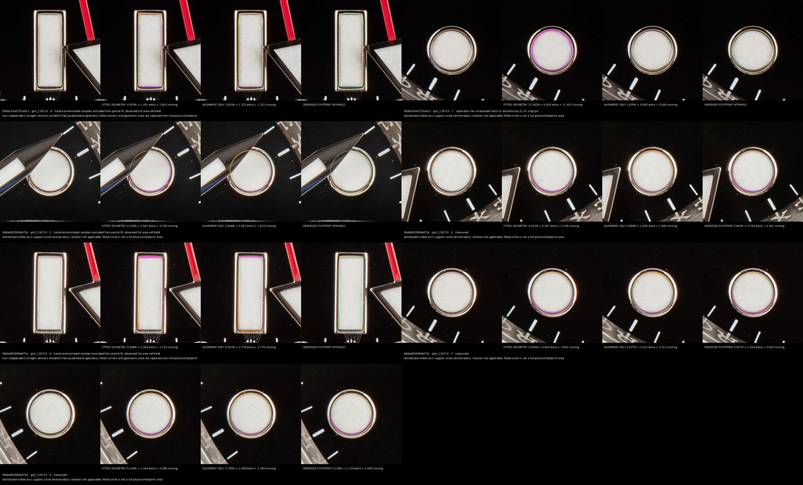
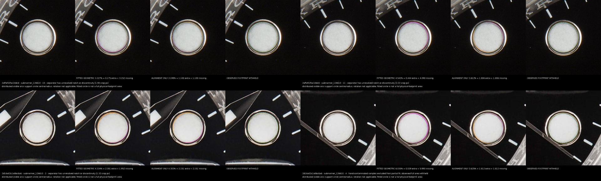

# Frozen luminous fit regression

Same forty Alpha107 originals and frozen reference polygons. Every previous usable physical polygon and recorded outer value is asserted unchanged. No reference derivation, harvesting or acceptance thresholds. Listing identities remain provisional.

| Model | Before observed | After observed | Fitted geometry | Alignment only | Partial alignment supported | Newly measurable from previous withholding |
|---|---:|---:|---:|---:|---:|---:|
| gmt_126710 | 59 | 77 | 138 | 138 | 145 | 79 |
| submariner_124060 | 120 | 120 | 126 | 126 | 141 | 21 |
| submariner_126610 | 63 | 76 | 130 | 130 | 132 | 68 |

Fitted geometry reconstructs independently determined sides/intersections or circle centre/radius. Alignment-only rigidly transforms the unchanged expected template. Observed physical footprint is separate. All three use the same filled expected area denominator and saved polygons/regions; percentages are never added. Unsupported dimensions and percentages remain withheld.

## Recovered comparison contact sheets

Diagnostics distinguish seed rejection, crop leakage, enclosed dark pixels, convexity, contour instability and missing separator evidence. Enclosed pixels may be a separator shadow in a merged luminous/metal mask; they are not automatically material holes.

## Limitations and lessons learned

Independent edge fits can support alignment without proving every physical corner. Fitted percentages include idealised extrapolation and may disagree with physical footprint percentages. Fit residual and subset stability are not complete photographic confidence intervals. Human inspection of recovered polygons is required; this report does not claim universal absence of false detections or manufacturing tolerances.
