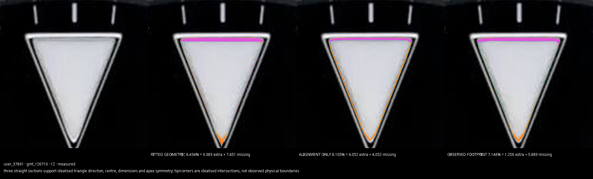
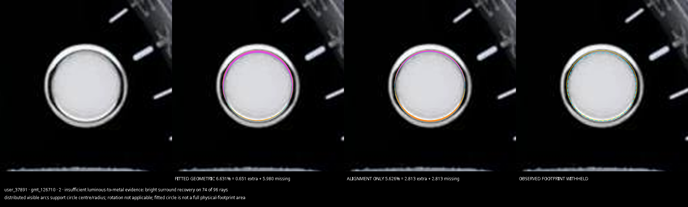
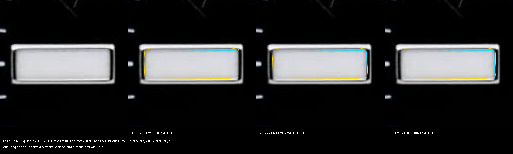
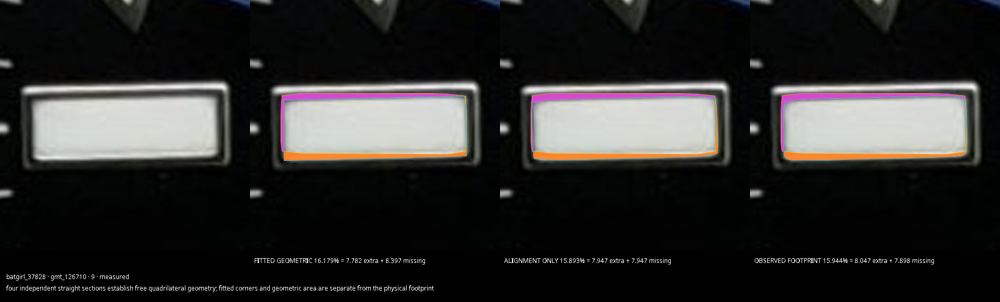
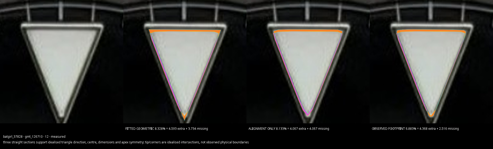
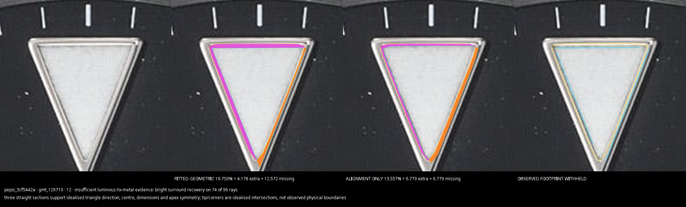

# Alpha107.2 local original-photo regressions

Unchanged originals, native frozen pose, baseline b8acf22c versus implementation 189313cb. No uploaded original is committed. Historical Pepsi is a regression control, not an additional independent genuine watch. Uploaded 37891 is user-described genuine, not an independently provenance-qualified reference.

| Original / hour | Before observed | After observed | Fitted geometry | Alignment only | Fitted direction |
|---|---:|---:|---:|---:|---:|
| user_37891 / 12 | withheld | 7.145614 | 8.434156 | 8.104901 | 0.017415 |
| user_37891 / 2 | withheld | withheld | 6.630798 | 5.625947 | withheld |
| user_37891 / 9 | withheld | withheld | withheld | withheld | -0.481809 |
| batgirl_37828 / 9 | 15.944486 | 15.944486 | 16.179324 | 15.893279 | -1.675393 |
| batgirl_37828 / 12 | 6.883068 | 6.883068 | 8.327824 | 8.133098 | -0.035154 |
| pepsi_3cf5442a / 12 | withheld | withheld | 16.749871 | 13.557312 | -0.435612 |

Percentages use the filled unchanged expected inner polygon. Fitted direction is degrees, clockwise positive. Fitted geometry includes idealised intersections/arcs; alignment-only rigidly places the expected polygon without changing size/shape; observed footprint requires reliable full physical boundary. Never add these percentages.

All 33 control-marker outer result fields are identical to baseline. Every previously usable observed luminous polygon and numerical field is identical. Batgirl outer 9 remains −1.1746053217373582°, WORTH; outer area/position remain withheld. Genuine Pepsi outer 9 remains 2.4212784736240094%, WITHIN. These outer results are separate from luminous percentages.

Uploaded 12 reproduction: dial radius 331.40746020144263 source pixels, 1187×1280 unchanged JPEG. All original threshold ladders failed because seed-connected masks enclosed dark pixels or had unresolved concavities. A merged polished/luminous mask can produce these categories even with a visibly complete inner insert. The new fallback follows observed local luminous-to-metal gradient separators, without using the expected template. The accepted full contour has 0.187462 source-pixel contrast-level movement; the fitted triangle has 0.311849 source-pixel residual. These are stability diagnostics, not a calibrated total uncertainty interval.

For withheld footprints, partial samples now require direct bright-metal recovery beyond an observed dark transition. One-way exits toward the dial cannot supply a claimed inner contour. Already accepted complete footprints also retain actual original contour samples for independent fitting, so successful measurements do not depend on polished recovery being visible on every side. Unmeasurable ends/short arcs keep dependent percentages withheld.

## Exact comparison images

### user_37891 / 12

### user_37891 / 2

### user_37891 / 9

### batgirl_37828 / 9

### batgirl_37828 / 12

### pepsi_3cf5442a / 12

Phone validation still required. Use the original, not a messaging-app resized copy. Inspect all three modes independently; cyan in alignment-only is the rigidly moved reference, not the measured physical contour. The inner references remain experimental and unchanged; no luminous pass/fail bands were added.
