# Frozen partial-edge genuine calibration

Measurement: `8a53c1e5ccb71d927a654a265572d34d9a5c3397`. [Actions](https://github.com/Biggregw/watch-align/actions/runs/38292226101). Research only; Android, both existing reference collections, production QC and PR #52 unchanged.

## Independent input and leakage audit

132 verified originals / 130 recorded listing groups / 128 conservative identity clusters. 123 clusters are provenance/identity eligible before any new measurement. Two source-conflicting GMT listings and all pre-existing shared-image identity suspects are quarantined. All originals, repeats, quarantines and withheld markers remain in the audit. Development/held-out split is dealer-stratified and hash-deterministic before measurement. No test image or replica enters the reference estimator.

| Family | Eligible provisional clusters | Clusters with fitted geometry | Fitted markers | Observed physical markers | Held-out clusters | Held-out fitted markers |
|---|---:|---:|---:|---:|---:|---:|
| gmt_126710 | 28 | 26 | 218 | 130 | 10 | 66 |
| submariner_124060 | 40 | 38 | 379 | 331 | 14 | 133 |
| submariner_126610 | 55 | 55 | 558 | 340 | 17 | 178 |

## Reference definitions

Each individual model/hour has its own development-only reference. There is no pooled round reference or borrowed marker-position tolerance. Triangle vertices are independent three-line intersections; baton quadrilaterals retain independently supported skew and nonparallel edges; circles retain free fitted centre/radius. Ring adjustment is removed with the frozen inverse transformation before watch-weighted coordinate medians, then restored exactly for scoring. Minimum three development clusters only permits an experimental geometry; it does not establish a distribution or tolerance. Missing geometry stays absent.

Observed physical luminous footprints have a separate development-only median radial-profile reference from full-boundary detections. Ideal fitted corners are never substituted for observed boundaries. A/B use the fitted genuine polygon; C uses its own genuine physical-footprint polygon. Every score uses `100*(extra+missing)/filled expected area` and retains its exact expected/actual polygons and regions. A, B and C are separate and never added.

## Held-out per-position fitted results

| Family | Hour / shape | Held-out measured / attempted | Old median fitted % | New median fitted % | New median alignment % | Largest new fitted % |
|---|---|---:|---:|---:|---:|
| gmt_126710 | 1 / round | 6 / 10 | 4.438733 | 3.212252 | 2.034734 | 13.740871 |
| gmt_126710 | 2 / round | 3 / 10 | 3.639217 | 3.250773 | 1.980988 | 3.690194 |
| gmt_126710 | 4 / round | 8 / 10 | 6.323136 | 5.725451 | 2.595243 | 12.183562 |
| gmt_126710 | 5 / round | 6 / 10 | 5.828000 | 5.104684 | 3.459817 | 8.141654 |
| gmt_126710 | 6 / baton | 4 / 10 | 2.479734 | 2.247781 | 1.745322 | 2.777134 |
| gmt_126710 | 7 / round | 8 / 10 | 7.433842 | 7.597002 | 3.951651 | 13.874367 |
| gmt_126710 | 8 / round | 7 / 10 | 6.761917 | 4.095198 | 3.264439 | 11.476577 |
| gmt_126710 | 9 / baton | 5 / 10 | 3.391024 | 3.428810 | 2.642878 | 4.132089 |
| gmt_126710 | 10 / round | 6 / 10 | 4.070044 | 3.223987 | 2.467306 | 3.971391 |
| gmt_126710 | 11 / round | 6 / 10 | 4.018748 | 2.551383 | 2.247333 | 12.978325 |
| gmt_126710 | 12 / triangle | 7 / 10 | 3.552355 | 3.081038 | 1.941543 | 15.263267 |
| submariner_124060 | 1 / round | 11 / 14 | 3.973728 | 4.179415 | 2.556740 | 9.034917 |
| submariner_124060 | 2 / round | 10 / 14 | 4.866442 | 5.996617 | 1.408577 | 60.569019 |
| submariner_124060 | 3 / baton | 7 / 14 | 5.468395 | 4.348537 | 3.205346 | 9.434140 |
| submariner_124060 | 4 / round | 11 / 14 | 4.804400 | 4.180387 | 3.165109 | 10.251293 |
| submariner_124060 | 5 / round | 12 / 14 | 4.234491 | 3.595451 | 2.284367 | 10.549158 |
| submariner_124060 | 6 / baton | 9 / 14 | 4.366883 | 3.970524 | 2.776032 | 5.140675 |
| submariner_124060 | 7 / round | 13 / 14 | 4.805226 | 5.119667 | 2.805169 | 10.418554 |
| submariner_124060 | 8 / round | 13 / 14 | 3.560531 | 3.722234 | 2.415468 | 9.341091 |
| submariner_124060 | 9 / baton | 9 / 14 | 5.665007 | 5.769779 | 4.575060 | 7.189529 |
| submariner_124060 | 10 / round | 12 / 14 | 2.978085 | 2.752122 | 1.925677 | 6.406957 |
| submariner_124060 | 11 / round | 14 / 14 | 4.025721 | 4.051500 | 2.247697 | 9.023875 |
| submariner_124060 | 12 / triangle | 12 / 14 | 5.482763 | 6.212381 | 4.552697 | 14.010578 |
| submariner_126610 | 1 / round | 17 / 17 | 3.288893 | 2.413674 | 1.874879 | 8.648002 |
| submariner_126610 | 2 / round | 14 / 17 | 4.883263 | 2.436595 | 2.015214 | 8.889189 |
| submariner_126610 | 4 / round | 17 / 17 | 7.253633 | 5.001096 | 3.965806 | 9.903609 |
| submariner_126610 | 5 / round | 17 / 17 | 7.201938 | 5.615845 | 3.480454 | 9.610655 |
| submariner_126610 | 6 / baton | 13 / 17 | 3.101647 | 2.553912 | 2.313502 | 10.895028 |
| submariner_126610 | 7 / round | 17 / 17 | 8.223313 | 6.444834 | 3.207917 | 11.373073 |
| submariner_126610 | 8 / round | 17 / 17 | 5.684227 | 3.931151 | 3.442901 | 12.305711 |
| submariner_126610 | 9 / baton | 17 / 17 | 3.429068 | 2.779847 | 2.921435 | 10.611768 |
| submariner_126610 | 10 / round | 17 / 17 | 2.768211 | 2.657123 | 1.878807 | 9.679594 |
| submariner_126610 | 11 / round | 16 / 17 | 2.339584 | 2.503715 | 2.068490 | 10.564171 |
| submariner_126610 | 12 / triangle | 16 / 17 | 3.928308 | 2.800695 | 2.191294 | 4.170514 |

Read `genuine_variation_by_position.csv` for separate development, held-out and conditional combined distributions, including extra/missing, displacement, direction, size, symmetry and withheld counts. Tail percentiles require >=20/40 provisional groups; absence of a percentile is intentional. Combined and training distributions are descriptive; held-out and development OOF test reference generalisation.

## Stability and photographic uncertainty

250 group bootstraps describe reference-estimation variation; five development-grouped folds describe out-of-fold stability without selecting estimator parameters. `source_leaveout.csv` removes each development dealer in turn where other groups support the same position. It cannot assess source bias for the all-Bobs 126610 sample. `same_cluster_repeat_photos.csv` contains two genuine repeated EWC photographs plus known shared-image hypotheses labelled separately. `processing_sensitivity.csv` reruns three preselected held-out originals under exact repeat, JPEG 95/85, 5/6 resize and brightness ±2%, with no change to original bytes. Their transformed copies are never independent watches. Exact-original repeats assert identical input fingerprints, pose, ring, measured polygons and scores.

## Outlier inspection

The gallery preserves largest held-out mismatches by model/shape and comparison, plus withheld examples. Each image includes native original crop (presentation scaling), the frozen rectified crop, exact fitted/alignment/observed polygons, orange extra and magenta missing, displacement, rotation and fit diagnostics. Source links/hashes remain in the manifest and index. A high score is not automatically a manufacturing defect; polished-edge choice, lighting, source processing and perspective can still dominate.

### gmt_126710 12 — 212c6d510bdfa0c6
[Original source](https://swisswatchexpo.com/watches/rolex-gmt-master-ii-batgirl-black-blue-bezel-steel-mens-watch-126710-unworn-68784) · Highest held-out score · new_fitted_total_pct
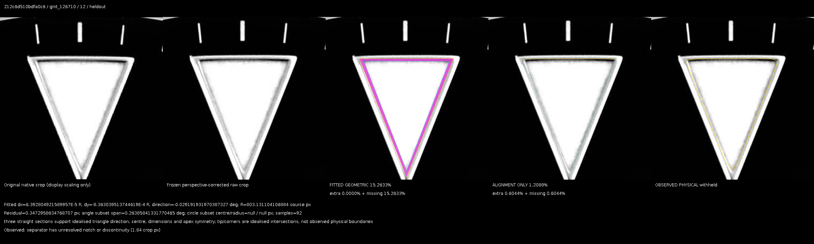

### gmt_126710 12 — a71df6c06e554d7b
[Original source](https://bobswatches.com/used-rolex-gmt-master-ii-pepsi-ref-126710blro.html) · Highest held-out score · new_fitted_total_pct
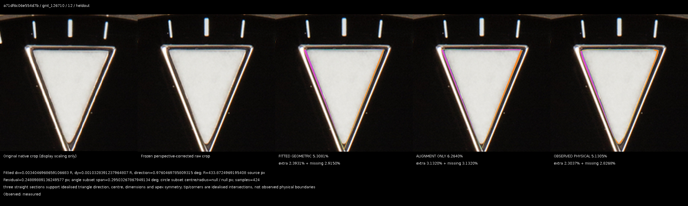

### gmt_126710 12 — 709160117d0d8944
[Original source](https://swisswatchexpo.com/watches/rolex-gmt-master-ii-black-blue-batman-bezel-steel-mens-watch-126710-68408) · Withheld evidence retained · withheld_example
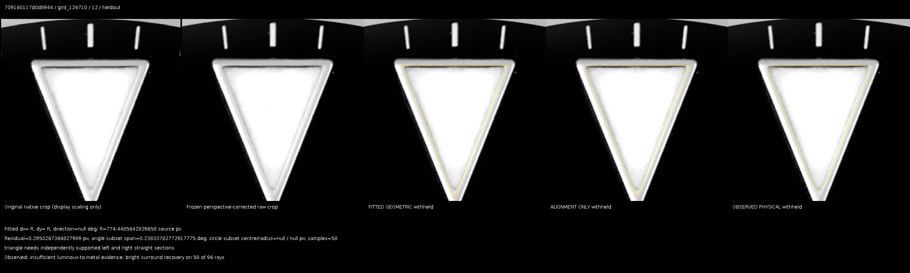

### gmt_126710 9 — c68ad7934502cfb2
[Original source](https://bobswatches.com/mens-rolex-gmt-master-ii-ref-126710-pepsi.html) · Highest held-out score · new_fitted_total_pct
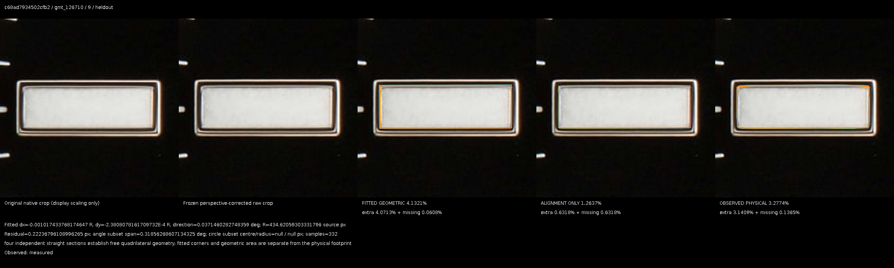

### gmt_126710 9 — a71df6c06e554d7b
[Original source](https://bobswatches.com/used-rolex-gmt-master-ii-pepsi-ref-126710blro.html) · Highest held-out score · new_fitted_total_pct
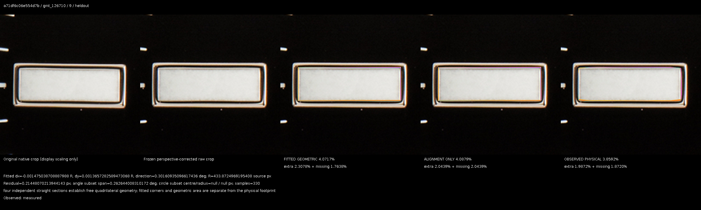

### gmt_126710 6 — a71df6c06e554d7b
[Original source](https://bobswatches.com/used-rolex-gmt-master-ii-pepsi-ref-126710blro.html) · Highest held-out score · new_observed_total_pct
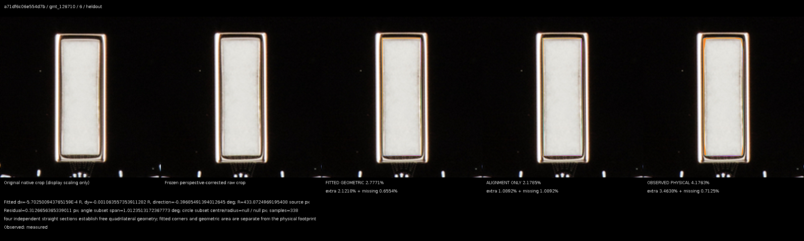

### gmt_126710 6 — 972c2f9279ee489c
[Original source](https://swisswatchexpo.com/watches/rolex-gmt-master-ii-batgirl-black-blue-bezel-steel-mens-watch-126710-unworn-59259) · Withheld evidence retained · withheld_example
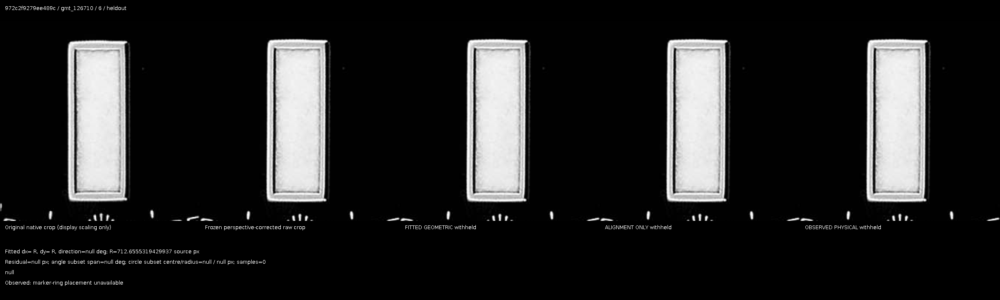

### gmt_126710 7 — 7f94f08a2015c94e
[Original source](https://bobswatches.com/pre-owned-batgirl-rolex-gmt-master-ii-ref-126710blnr-jubilee-bracelet.html) · Highest held-out score · new_fitted_total_pct
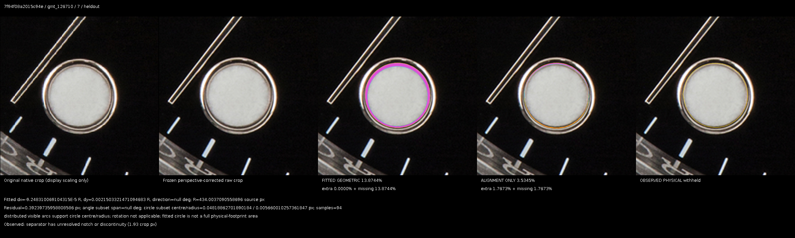

### gmt_126710 1 — 212c6d510bdfa0c6
[Original source](https://swisswatchexpo.com/watches/rolex-gmt-master-ii-batgirl-black-blue-bezel-steel-mens-watch-126710-unworn-68784) · Highest held-out score · new_fitted_total_pct
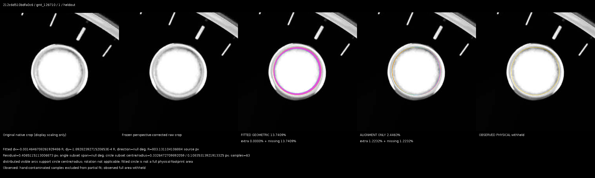

### gmt_126710 7 — 709160117d0d8944
[Original source](https://swisswatchexpo.com/watches/rolex-gmt-master-ii-black-blue-batman-bezel-steel-mens-watch-126710-68408) · Highest held-out score · new_alignment_total_pct
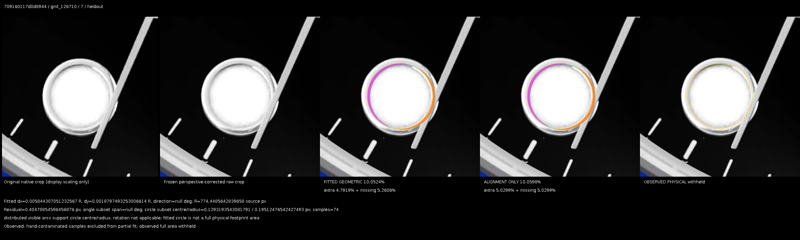

### gmt_126710 4 — c68ad7934502cfb2
[Original source](https://bobswatches.com/mens-rolex-gmt-master-ii-ref-126710-pepsi.html) · Highest held-out score · new_observed_total_pct
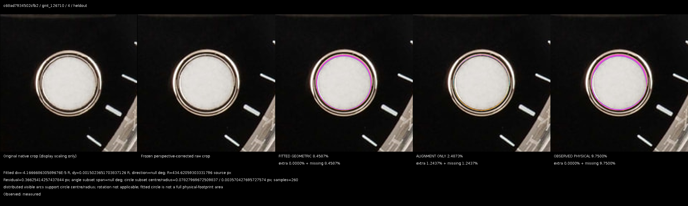

### gmt_126710 2 — 212c6d510bdfa0c6
[Original source](https://swisswatchexpo.com/watches/rolex-gmt-master-ii-batgirl-black-blue-bezel-steel-mens-watch-126710-unworn-68784) · Withheld evidence retained · withheld_example
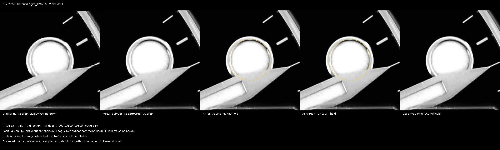

### submariner_124060 12 — f97405415bac87e3
[Original source](https://www.europeanwatch.com/watch/rolex-124060-submariner-124060-no-date-ceramic-bezel-41mm-39410) · Highest held-out score · new_fitted_total_pct
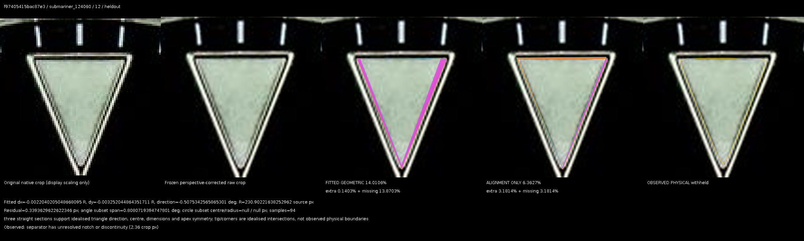

### submariner_124060 12 — f27a64f84579f41b
[Original source](https://www.swisswatchexpo.com/watches/rolex-submariner-non-date-ceramic-bezel-steel-mens-watch-124060-47665) · Highest held-out score · new_fitted_total_pct
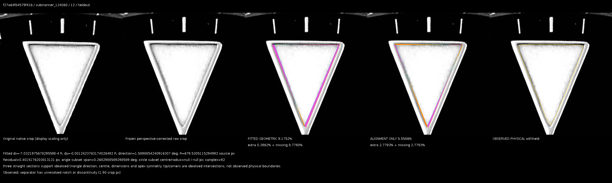

### submariner_124060 12 — 57baf569cec2a1fa
[Original source](European Watch Company) · Highest held-out score · new_alignment_total_pct
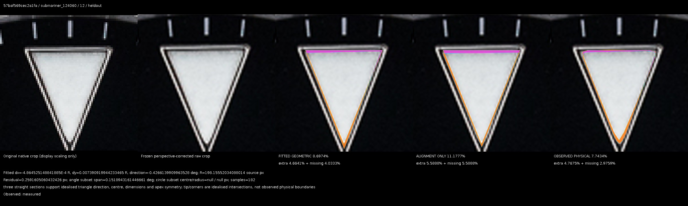

### submariner_124060 12 — 3cce6d1b709364b0
[Original source](https://davidsw.com/shop/watch/rolex/rolex-124060-submariner-41-no-date-156) · Highest held-out score · new_observed_total_pct
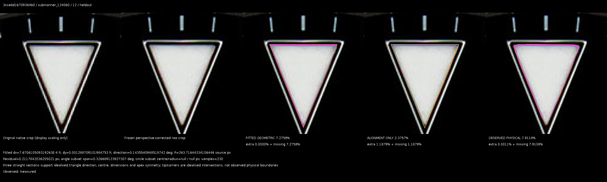

### submariner_124060 12 — 80d288dcc8689345
[Original source](European Watch Company) · Withheld evidence retained · withheld_example
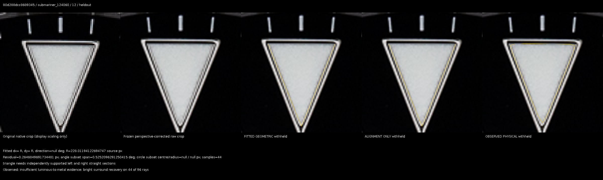

### submariner_124060 3 — d2d17532532ec40b
[Original source](https://www.bobswatches.com/rolex/submariner-124060) · Highest held-out score · new_fitted_total_pct
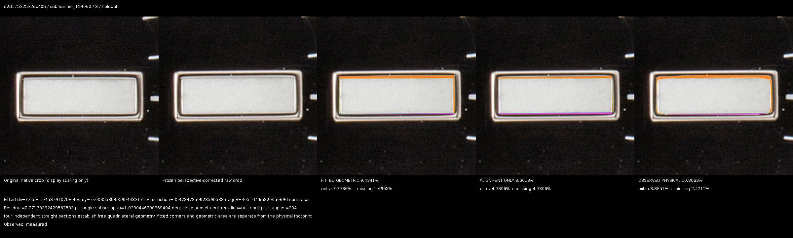

### submariner_124060 3 — e4ea736606798ecd
[Original source](https://www.bobswatches.com/used-stainless-steel-rolex-submariner-ref-124060-no-date-black-dial.html) · Highest held-out score · new_fitted_total_pct
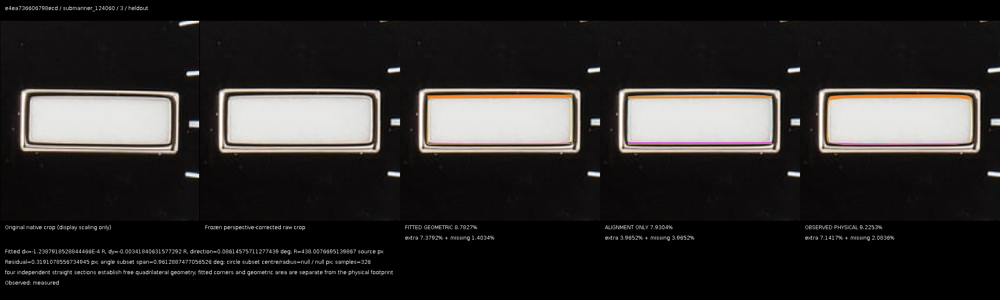

### submariner_124060 2 — 80d288dcc8689345
[Original source](European Watch Company) · Highest held-out score · new_fitted_total_pct
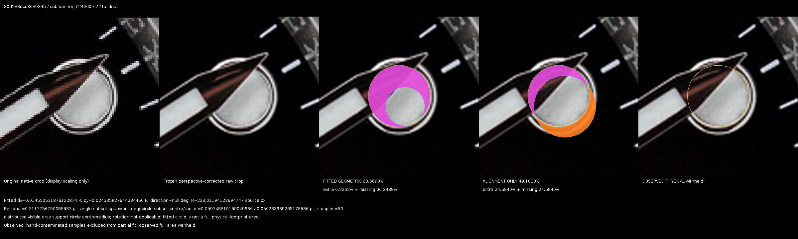

### submariner_124060 5 — d2d17532532ec40b
[Original source](https://www.bobswatches.com/rolex/submariner-124060) · Highest held-out score · new_fitted_total_pct
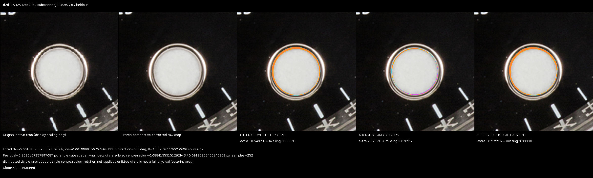

### submariner_124060 4 — 033133202cf757da
[Original source](https://davidsw.com/shop/watch/rolex/rolex-124060-submariner-41-no-date-53) · Withheld evidence retained · withheld_example
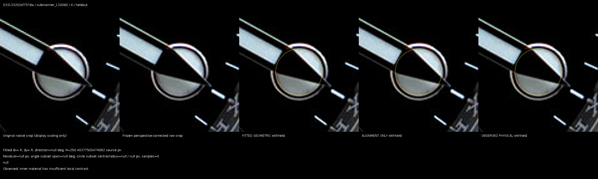

### submariner_126610 12 — 1b2741bc0119257c
[Original source](https://www.bobswatches.com/pre-owned-rolex-submariner-chromalight-dial-ref-126610ln-stainless-steel.html) · Highest held-out score · new_fitted_total_pct
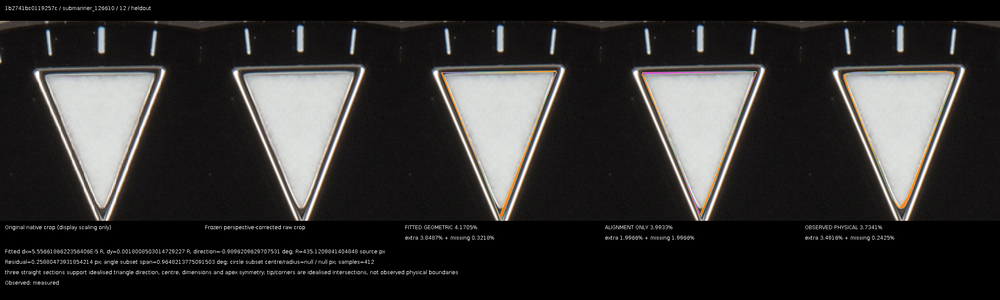

### submariner_126610 12 — ba3762aa2aea60c1
[Original source](https://www.bobswatches.com/used-stainless-steel-rolex-submariner-ref-126610ln-black-dial.html) · Highest held-out score · new_fitted_total_pct
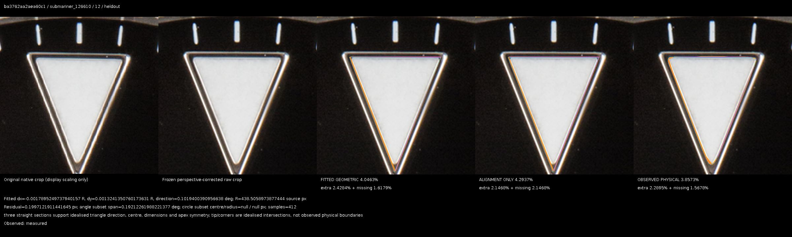

### submariner_126610 12 — fc58318fbc25608f
[Original source](https://www.bobswatches.com/pre-owned-rolex-submariner-black-chromalight-dial-ref-126610ln.html) · Highest held-out score · new_observed_total_pct
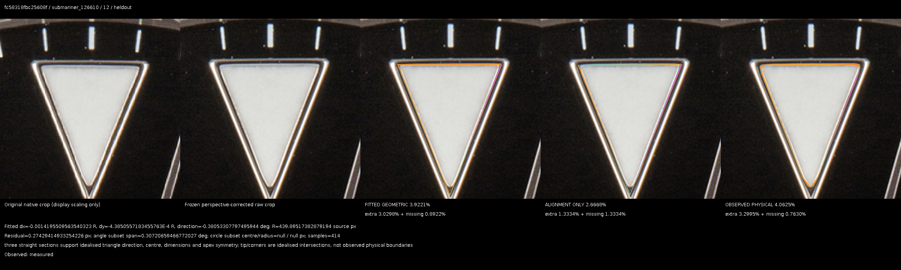

### submariner_126610 12 — 581fb930196aa829
[Original source](https://www.bobswatches.com/used-starbucks-rolex-submariner-ref-126610lv.html) · Withheld evidence retained · withheld_example
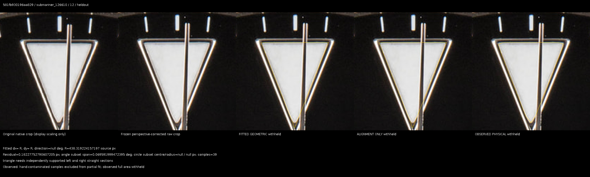

### submariner_126610 6 — 4e7e9485023eccb2
[Original source](https://www.bobswatches.com/pre-owned-stainless-steel-rolex-submariner-126610ln.html) · Highest held-out score · new_fitted_total_pct
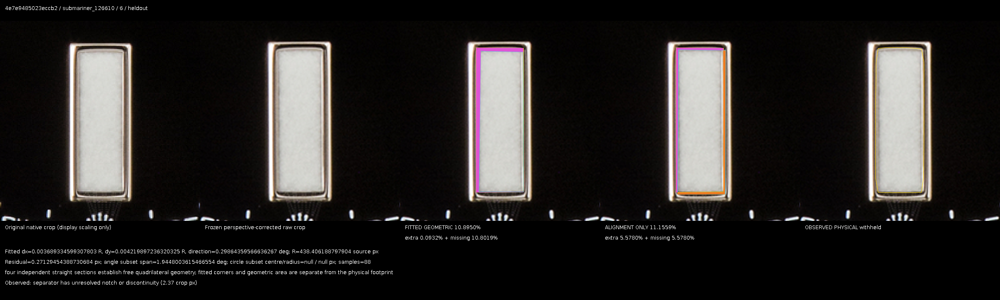

### submariner_126610 9 — 4e7e9485023eccb2
[Original source](https://www.bobswatches.com/pre-owned-stainless-steel-rolex-submariner-126610ln.html) · Highest held-out score · new_fitted_total_pct
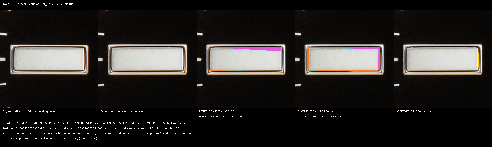

### submariner_126610 9 — 5d345c84b7a33a84
[Original source](https://www.bobswatches.com/used-rolex-submariner-ref-126610-black-dial.html) · Highest held-out score · new_observed_total_pct
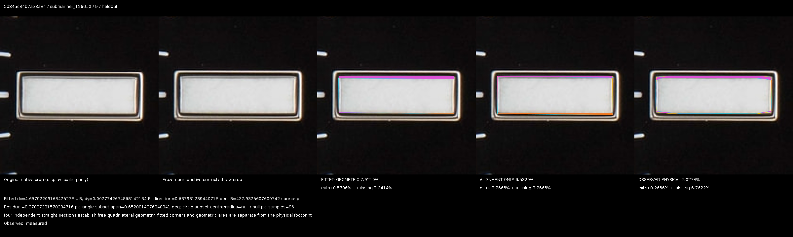

### submariner_126610 8 — 1b2741bc0119257c
[Original source](https://www.bobswatches.com/pre-owned-rolex-submariner-chromalight-dial-ref-126610ln-stainless-steel.html) · Highest held-out score · new_fitted_total_pct
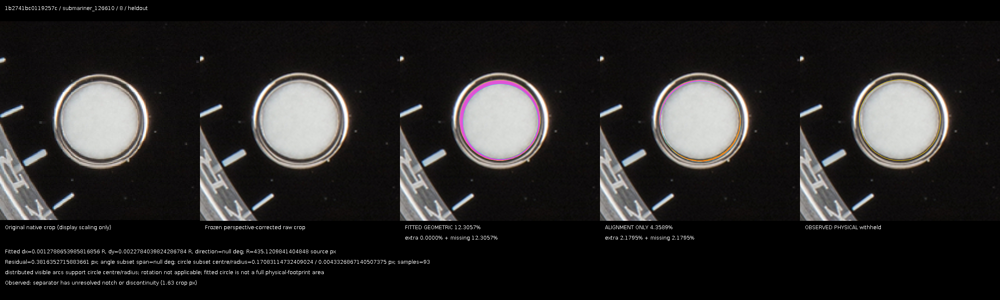

### submariner_126610 7 — 9f0e707ad066ee21
[Original source](https://www.bobswatches.com/used-rolex-submariner-steel-oyster-126610-black-dial.html) · Highest held-out score · new_fitted_total_pct
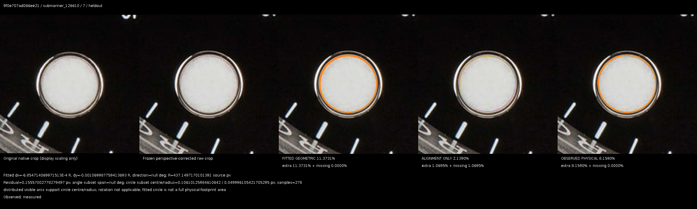

### submariner_126610 1 — 73f994775fa1f3f5
[Original source](https://www.bobswatches.com/pre-owned-rolex-submariner-ref-126610lv-starbucks-stainless-steel.html) · Highest held-out score · new_alignment_total_pct
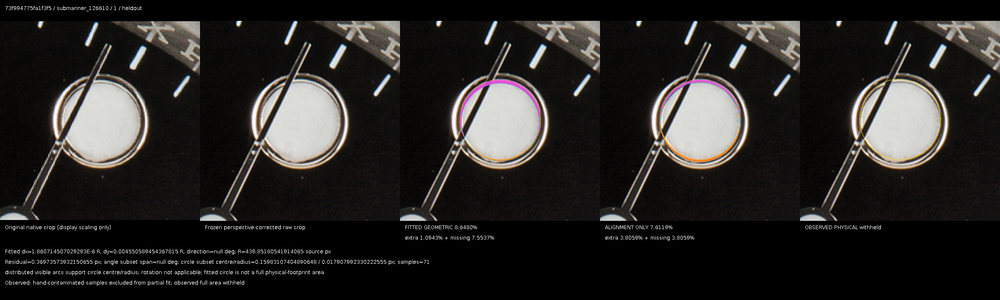

### submariner_126610 8 — fc58318fbc25608f
[Original source](https://www.bobswatches.com/pre-owned-rolex-submariner-black-chromalight-dial-ref-126610ln.html) · Highest held-out score · new_observed_total_pct
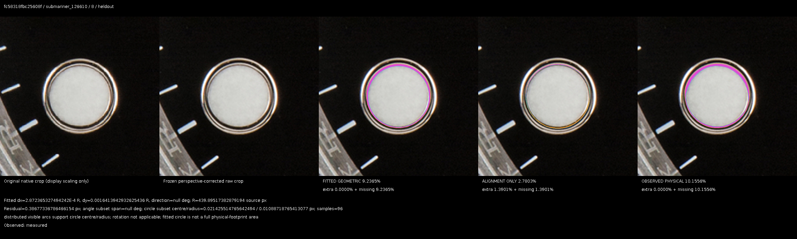

### submariner_126610 2 — 1b2741bc0119257c
[Original source](https://www.bobswatches.com/pre-owned-rolex-submariner-chromalight-dial-ref-126610ln-stainless-steel.html) · Withheld evidence retained · withheld_example
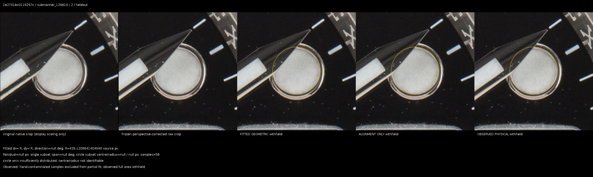

## Limits and recommendation before visual review

- Groups are provisional listing/identity clusters, not serial-authenticated independent watches.
- Held-out is for new reference estimation; this collection previously informed detector development.
- 126610 entirely Bobs Watches: no independent source validation.
- Frozen gate clearance and low residual do not prove the correct physical luminous edge.
- Processing changes and source/lighting can alter geometry; observed variation is not factory tolerance.
- No independent metrology or human replica-acceptance labels support thresholds.

References are provisional research outputs, not an Android update, factory tolerance, authentication verdict or replica acceptance band. Review the worst genuine fits before deciding whether the current edge evidence is sufficient for future production integration.

## LESSONS LEARNED

Matching the geometry-estimation definition removes a known source of systematic comparison error; it cannot make photographic uncertainty disappear. A source-biased, single-photo collection cannot independently identify physical manufacturing spread. Per-position withholding and frozen held-out evaluation are necessary even when the same-method median fits better.
